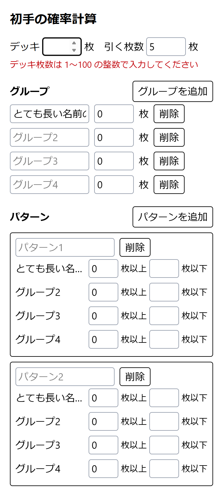
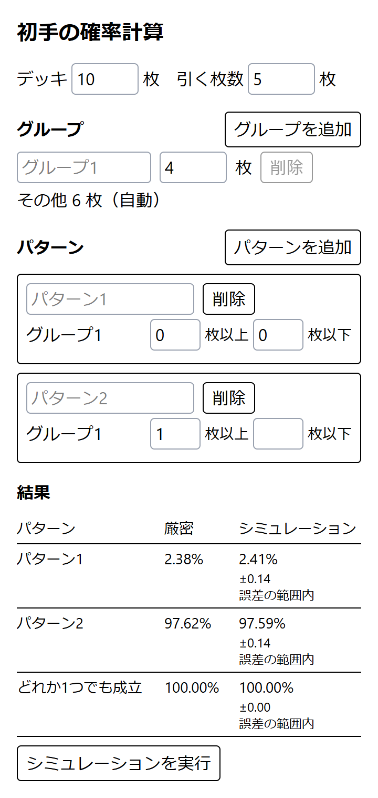

# 初手の確率計算（hand-odds）

デッキをグループに分けて枚数を入れると、初手で条件を満たす確率が分かるツールです。
厳密な計算（多変量の超幾何分布）とシミュレーションの両方で求め、並べて表示します。計算はすべてブラウザの中で行い、入力は外部へ送りません。

**公開 URL：<https://nno0p72gg0akabe-coder.github.io/hand-odds/>**（スマートフォンでも使えます）

| 入力 | 結果 |
|---|---|
|  |  |

画面の例は、手で導ける 10 枚のデッキです（幅 360px で撮影）。

## できること

- カードをグループに分け、それぞれの枚数と、初手で引く枚数を入力する
- パターンごとに、グループごとの「◯枚以上・◯枚以下」を条件にする
- パターンを複数置き、「どれか1つでも成立する」確率を求める
- 厳密な計算とシミュレーション（10万回）を並べて表示する。シミュレーションには ±誤差を付け、厳密な値が「誤差の範囲内」かどうかも示す
- 入力の誤りや、成立しえない条件は、その場で表示する

## 対象外にしたもの・今後の候補

- 対象外：特定のゲームのカードデータ、マリガン（引き直し）やターンごとのドロー、ログイン・DB・保存
- 今後の候補：入力の保存・共有、引き直しの計算

## 使用技術

- Vite / React / TypeScript / Tailwind CSS
- テスト：Vitest + React Testing Library
- リント：oxlint
- 自動チェック・公開：GitHub Actions、GitHub Pages

## 起動方法

```bash
npm install
npm run dev     # 開発サーバー（http://localhost:5173/hand-odds/）
npm test        # テスト
npm run lint    # リント
npm run build   # 型チェック + ビルド
```

## この作品の作り方

### なぜ作ったか

メインのポートフォリオ（家計簿アプリ）は、私が AI と一緒に手を動かして作っています。
この作品は逆に、**実装を AI（Claude Code）に全部任せ**、私は要件定義と受け入れ判定だけを行いました。
「任せて、検収して、品質を保つ」やり方を示すためのものです。

### 役割分担

| だれ | やること |
|---|---|
| 依頼者（私） | 要件定義、検算表の作成、プルリクエストの取り込み・差し戻しの判定、認証が要る操作（GitHub の設定など） |
| 作り手（Claude Code） | 実装、テスト、文書、課題とプルリクエストの作成 |

### 任せるための仕組み

決まりは [CLAUDE.md](CLAUDE.md)、設計は [設計書](docs/superpowers/specs/2026-11-16-hand-odds-design.md)（5 章がこの仕組み）、作業手順は [計画](docs/superpowers/plans/2026-11-16-hand-odds.md) にあります。

- **検算表は依頼者のもの**：私が手計算した「入力と正解」の表（[docs/acceptance/kensan.md](docs/acceptance/kensan.md)）を、作り手はそのままテスト（`src/calc/kensan.test.ts`）にします。表もテストの期待値も、作り手は変えません。通らなければ実装を直すか、表の誤りの疑いを根拠つきで報告します
- **課題 → プルリクエスト → 自動チェック → 依頼者の判定**：[課題](https://github.com/nno0p72gg0akabe-coder/hand-odds/issues?q=is%3Aissue) 1件につきプルリクエスト 1件（[取り込み済みの一覧](https://github.com/nno0p72gg0akabe-coder/hand-odds/pulls?q=is%3Apr+is%3Aclosed)）。型チェック・リント・テスト・ビルドの自動チェック（`check`）が通らないと取り込めず、取り込めるのは私だけ。main は保護しています
- **プルリクエストの型**：[テンプレート](.github/pull_request_template.md)で「何をしたか／なぜ／どう確かめたか／自分で決めたこと／特に見てほしい点」を必ず書かせ、全部のコードを読まなくても判定できるようにしました
- **判断の記録**：作り手が自分で決めた、後から変えにくいことを 1件 1ファイルで残しています

  | 記録 | 要点 |
  |---|---|
  | [0001](docs/decisions/0001-static-site.md) | サーバーも DB も持たない静的サイトにする |
  | [0002](docs/decisions/0002-acceptance-order.md) | 検算の順番を「実装の前」から「公開の前」に変える |
  | [0003](docs/decisions/0003-exact-calculation.md) | 厳密な計算は、初手の内訳を全部数え上げて BigInt で合計する |
  | [0004](docs/decisions/0004-simulation.md) | シミュレーションは種つき乱数、メインスレッドで動かす |

- **独立した 2 つの方法で突き合わせ**：厳密な計算とシミュレーションを、種を固定して複数の入力で突き合わせ、全組み合わせの確率の合計が 1 になることも確かめます
- **検算の順番の変更**：当初は「検算表が先、実装が後」でしたが、検算表を待つあいだ作業が止まるため、「計算の実装は先に進めてよい。ただし私が表を記入し終えるまで、計算の値は私に見せない（見ると手計算が答え合わせに引っ張られる）。表の全件が通るまで公開しない」に変えました（[0002](docs/decisions/0002-acceptance-order.md)）
- **レビュー**：各タスクは 1つの AI が実装し、別の AI がレビューします。指摘を直したら、もう一度レビューします。プルリクエストの説明に残っている例：
  - 実ブラウザの幅 360px のスクリーンショットで、パターンの条件の行で「枚以下」だけが次の行に折り返すのを見つけた（コードのレビューは通っていた）
  - 判断の記録に事実と違う記述を見つけ、直させた（0003 の「合計が Number の上限 2^53 に近づく」、0004 の「判定の関数を共有している」）
  - 高速化で「条件を満たすか」の判定が 2 か所に分かれ、片方にテストがない状態を、その関数の単体テストと、70 通りの手札の総当たりとの一致テストで縛った
  - 結果の表で、警告が出たときだけ列が広がる（外側の欄の折り返し禁止が警告の行に効いていた）のを、再レビューがコードから見つけた

### 量の実績

| 項目 | 実績 | 上限 |
|---|---|---|
| テストを除くコード | 506 行 | 800 行 |
| プルリクエスト | 8 件（#9〜#15 と、公開と README のこの 1 件） | 10 件 |

行数は、`src/` の `*.ts` / `*.tsx` から、テスト（`*.test.ts(x)`、`src/test/`）を除いて数えた値です。

```bash
find src -type f \( -name '*.ts' -o -name '*.tsx' \) ! -name '*.test.ts' ! -name '*.test.tsx' ! -path 'src/test/*' | xargs cat | wc -l
```

## テスト

98 件（9 ファイル）が通ります。

- 単体：入力の検査（19）、画面の状態（14）、厳密な計算（18）、シミュレーション（15。うち 12 件が厳密な計算との突き合わせ：4 種類の入力 × 3 つの種、各 10 万回）、表示の整形（5）、誤差の目安と範囲内の判定（2）
- 画面：入力から結果までの操作（12）、結果の表（8）
- 突き合わせ：上のシミュレーションの 12 件。ほかに、確率の合計が 1 になることと、70 通りの手札の総当たりを `exact.test.ts` で確かめています
- 受け入れ：検算表 5 件（`src/calc/kensan.test.ts`）。これが通らないと [deploy.yml](.github/workflows/deploy.yml) は公開しません
